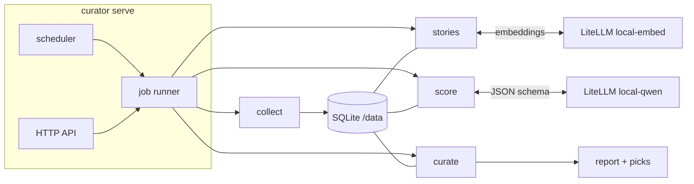

# content-curator

[](https://github.com/warroyo/content-curator/actions/workflows/image.yaml)

## Overview

A self-hosted curator that reads a few hundred feed items a day and picks the 5–10 worth your time. It collects RSS and Atom feeds and podcasts, finds new podcast shows on its own, drops duplicates, has a local model score each item against an interest profile, and selects a small, diverse set with a reason for each pick. It writes the picks to a markdown report and, with publishing on, saves them to a Raindrop.io collection with the reason as the bookmark's note. Links you save to a Raindrop inbox collection get the same treatment.

It runs as one container: a small service with an HTTP API, a built-in scheduler and Prometheus metrics. It sleeps between runs, using almost no CPU, and does its work overnight. The model is any OpenAI-compatible endpoint; in the home lab that is LiteLLM's `local-qwen` alias on `ubuntu-home`.

## How it works



- The scheduler starts the nightly `run` job (collect, stories, score, curate) from `config/app.yaml`. The API starts the same jobs on demand and serves status, picks and item explanations.
- `collect` fetches sources with conditional requests, gets full text from the feed or the page (respecting `robots.txt`), and marks items with the same URL, canonical URL or text as duplicates.
- Podcast episodes are scored on show notes and published transcripts and linked to Apple Podcasts. A weekly `discover` job finds new shows and checks feeds suggested through `POST /api/candidates`; the good ones run as trials, and a `follow` or `unfollow` tag on a pick in Raindrop keeps or drops its source.
- `stories` embeds each fresh item with `local-embed` and groups articles about the same event, so one story yields one pick.
- `score` sends each fresh item to the model and validates six 0–10 scores, topics and a one-line explanation. Scores are cached.
- `curate` computes the weighted overall score in code, fills discovery slots, caps items per source, publishes the picks to Raindrop (when `publish.enabled`) and writes the report.

## Quick start

Prerequisites: Docker 24+ with the compose plugin, and an OpenAI-compatible endpoint with a key.

1. Configure the endpoint:
   ```sh
   cp .env.example .env   # set CURATOR_LLM_API_KEY, and CURATOR_RAINDROP_TOKEN to publish
   ```
2. Edit `config/sources.yaml`, `config/interests.yaml` and the schedule in `config/app.yaml`.
3. Start the service and run the pipeline once:
   ```sh
   make up
   make run                                   # POST /api/jobs/run
   make status                                # GET /api/status
   make picks                                 # latest report
   ```
4. Run the tests:
   ```sh
   make test
   ```

API and CLI reference: [docs/architecture.md](docs/architecture.md#api).

## Repo structure

- `src/content_curator/` - the application: `service.py` (API, scheduler), `jobs.py`, `stories.py`, `collectors/`, `ingest.py`, `scoring.py`, `select.py`, `publish.py`, `report.py`, `cli.py`
- `config/` - defaults for local runs: `app.yaml` (schedule, publishing), `sources.yaml` (source registry), `interests.yaml` (profile, weights, selection budget). A deployment mounts its own at `/config`
- `.github/workflows/image.yaml` - tests, then publishes `ghcr.io/warroyo/content-curator` on pushes to main
- `tests/` - unit and mocked integration tests, run in the `test` image target
- `Dockerfile`, `compose.yaml`, `Makefile` - build, test and run everything in Docker
- `docs/architecture.md` - components, API, data model, resource use, failure handling
- `docs/configuration.md` - environment variables and YAML reference
- `docs/decisions.md` - why it is built this way
